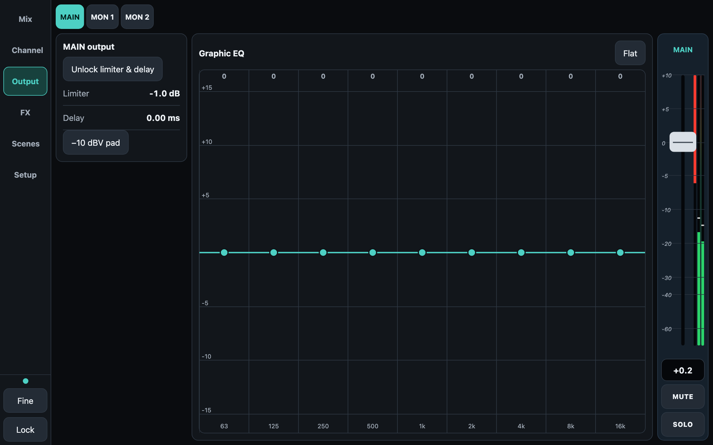
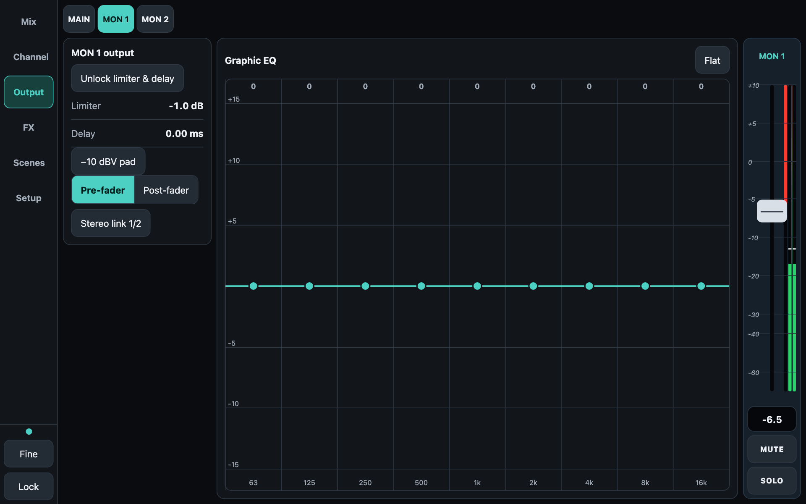
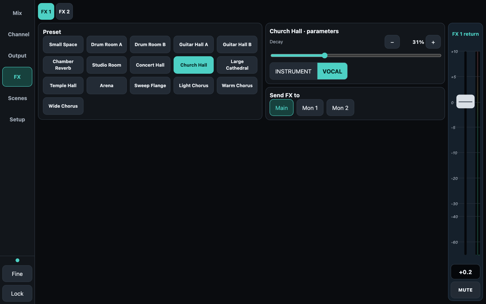
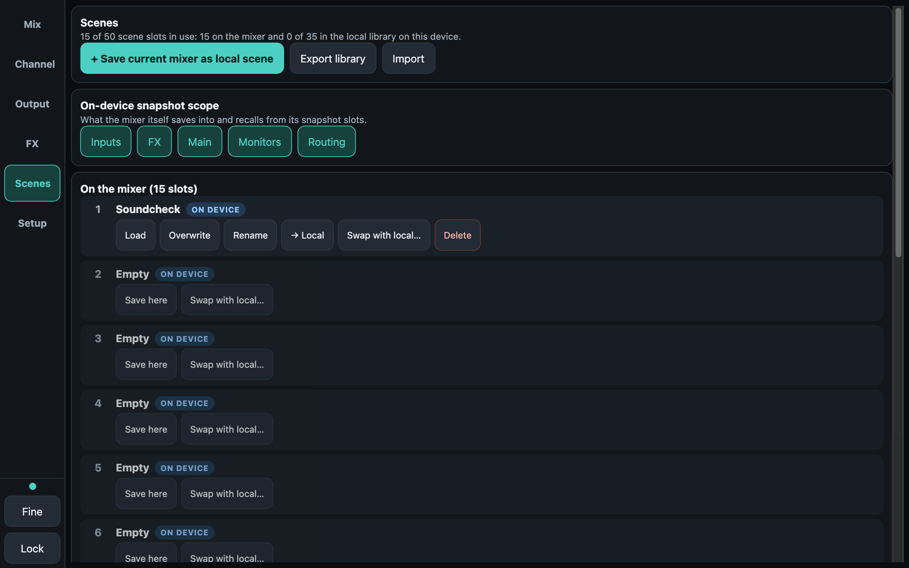
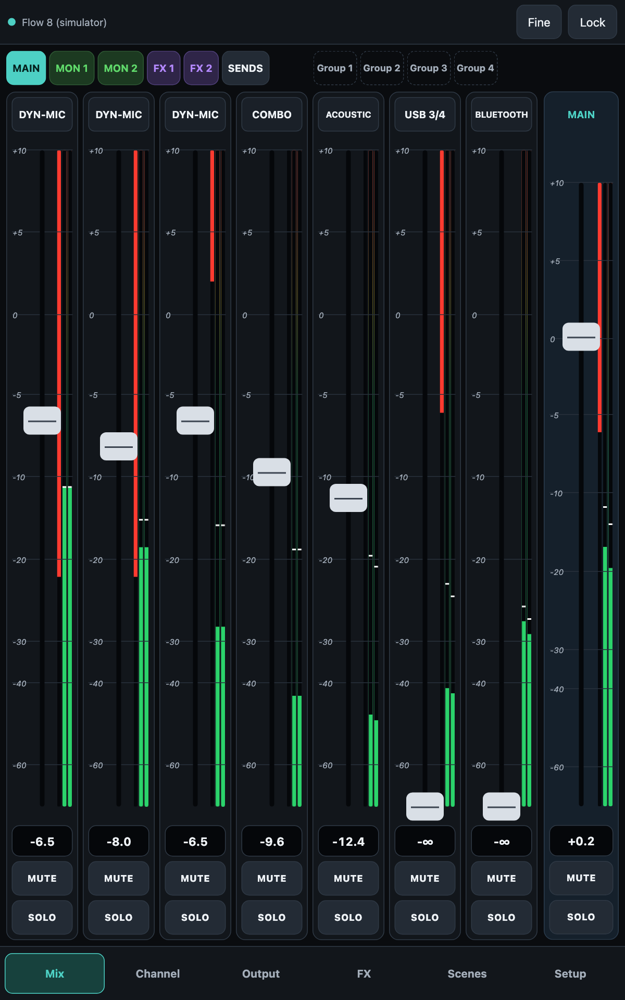
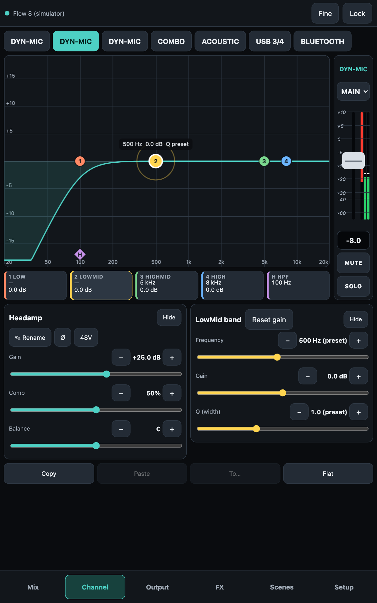

# ReFlo+

A free, touch-first controller for the Behringer Flow 8, built for working live techs. Fader strips for every mix, a drag-to-edit parametric EQ, graphic EQ, FX control, output limiter and delay, a sends matrix, scenes and mute groups, over Bluetooth, on your phone or tablet.

**Free to download and use. No account, no ads, no tracking, no internet needed.**

## Download

Get the latest APK (Android) or IPA (iPhone / iPad) from the **[Releases page](../../releases/latest)**.

- **Android** (8 or newer): download the APK, open it, allow installs from unknown apps when asked, and choose Install anyway if Play Protect warns.
- **iPhone / iPad**: the IPA is unsigned; install it with a sideloading tool such as AltStore, SideStore, Sideloadly or TrollStore.
- Press **Pairing** on the Flow 8, open ReFlo+, tap **Connect to Mixer**. Close the official FLOW Mix app first: the mixer accepts only one control connection.

## Screenshots

All taken with the built-in simulator, so the levels are demo values. Tablet in landscape, plus portrait for phones.

### Mix
Fader strips for every mix, with level meters and a red gain-reduction bar. Four mute-group buttons sit beside the mix selector.

Monitor mixes are outlined green, so you can see at a glance you are adjusting a monitor send.

FX sends are outlined purple.

### Sends matrix
Every input against every mix on one screen, FX returns included.

### Channel
Headamp, a drag-to-edit parametric EQ with low cut, and the channel's own fader and meter.

### Output
Graphic EQ for Main and the monitors. Limiter and delay are locked until you unlock them.

### FX
Presets by name, parameters, routing and the return fader.

### Scenes
The mixer's snapshot slots plus a local library, 50 in total.

### Portrait
On phones and narrow tablets the navigation moves to the bottom.

 

## Good to know

ReFlo+ uses its own names for the FX presets, so they may not match the names in the official app. The effects themselves are the mixer's.

## Support

Found a bug or want a feature? Join the Flow 8 Facebook groups and reach out to me there (Michael Wright). Please say which device and Android / iOS version you use.

## Licence and disclaimer

Free to use, closed source, under the freeware licence in [LICENSE](LICENSE). Please don't sell or repackage it.

ReFlo+ is an independent project, not made, endorsed or supported by Behringer or Music Tribe. "Behringer" and "Flow 8" are trademarks of their owners, used only to say which mixer it works with. It sends live control commands to a mixer (levels, phantom power, routing): use it at your own risk and check settings before a show.

by Michael Wright
