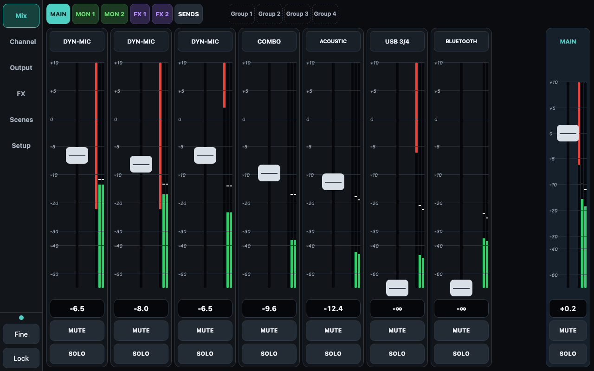

# ReFlo+

A free, touch-first controller for the Behringer Flow 8, built for working live techs. Fader strips for every mix, a drag-to-edit parametric EQ, graphic EQ, FX control, output limiter and delay, a sends matrix, scenes and mute groups, over Bluetooth, on your phone or tablet.

**Free to download and use. No account, no ads, no tracking, no internet needed.**

## Download

Get the latest APK (Android) or IPA (iPhone / iPad) from the **[Releases page](../../releases/latest)**.

- **Android** (8 or newer): download the APK, open it, allow installs from unknown apps when asked, and choose Install anyway if Play Protect warns.
- **iPhone / iPad**: the IPA is unsigned; install it with a sideloading tool such as AltStore, SideStore, Sideloadly or TrollStore.
- Press **Pairing** on the Flow 8, open ReFlo+, tap **Connect to Mixer**. Close the official FLOW Mix app first: the mixer accepts only one control connection.

## Support

Found a bug or want a feature? Open an issue on this page. Please say which device and Android / iOS version you use.

## Licence and disclaimer

Free to use, closed source, under the freeware licence in [LICENSE](LICENSE). Please don't sell or repackage it.

ReFlo+ is an independent project, not made, endorsed or supported by Behringer or Music Tribe. "Behringer" and "Flow 8" are trademarks of their owners, used only to say which mixer it works with. It sends live control commands to a mixer (levels, phantom power, routing): use it at your own risk and check settings before a show.

by Michael Wright
