# ReFlo+

A free, touch-first controller for the Behringer Flow 8, built for working live techs. Fader strips for every mix, a drag-to-edit parametric EQ with a full-screen mode, an output EQ that works as a nine-band GEQ or fully parametric, FX control, output limiter and delay, a sends matrix, scenes and mute groups, over Bluetooth, on your phone or tablet.

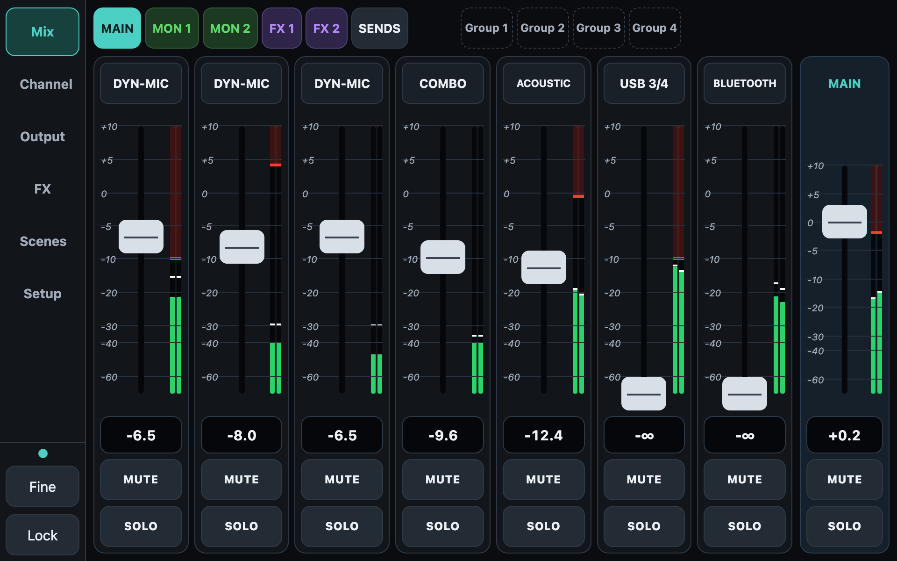

**Free to download and use. No account, no ads, no tracking, no internet needed.**

## Download

Get the latest APK (Android) or IPA (iPhone / iPad) from the **[Releases page](../../releases/latest)**.

- **Android** (8 or newer): download the APK, open it, allow installs from unknown apps when asked, and choose Install anyway if Play Protect warns.
- **iPhone / iPad**: the IPA is unsigned; install it with a sideloading tool such as AltStore, SideStore, Sideloadly or TrollStore.
- Press **Pairing** on the Flow 8, open ReFlo+, tap **Connect to Mixer**. Close the official FLOW Mix app first: the mixer accepts only one control connection.

## No mixer? Try the demo

Tap **Try the demo** on the first screen to run the whole app against a pretend Flow 8, so you can look around before you buy or connect anything. **Leave demo** in the header takes you back.

## Screenshots

All taken with the built-in demo (a pretend Flow 8), so the levels are demo values. Tablet in landscape first, then phone.

### Mix
Fader strips for every mix, with level meters and a gain-reduction overlay that hangs from the top of each meter (a light red body with a solid edge showing how far it reaches). Four mute-group buttons sit beside the mix selector.

Monitor mixes are outlined green, so you can see at a glance you are adjusting a monitor send.

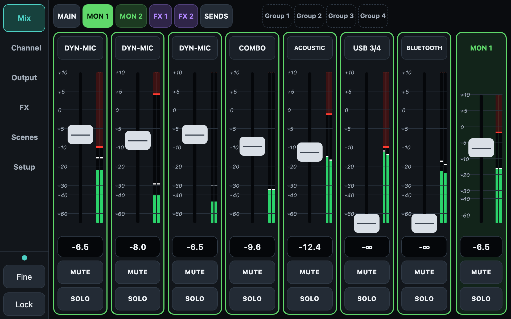

FX sends are outlined purple.

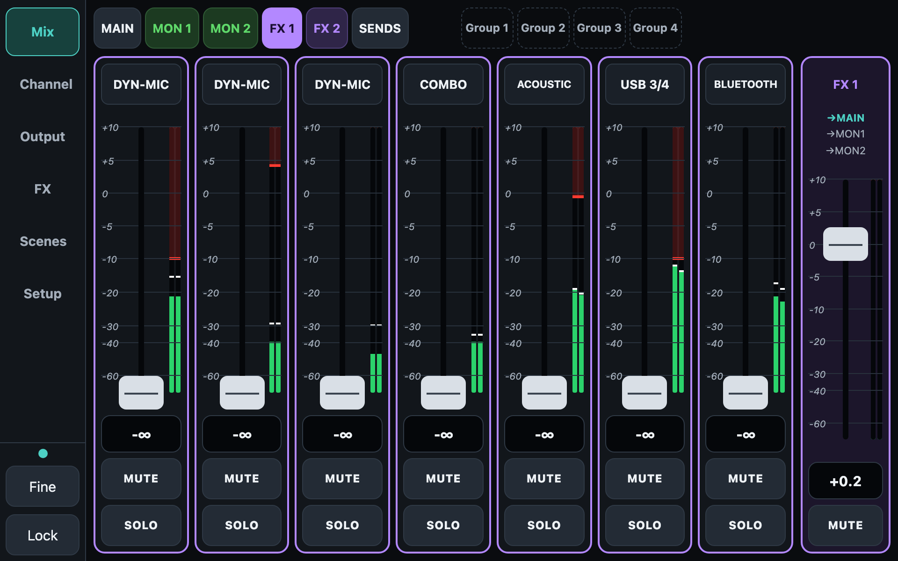

### Sends matrix
Every input against every mix on one screen, FX returns included.

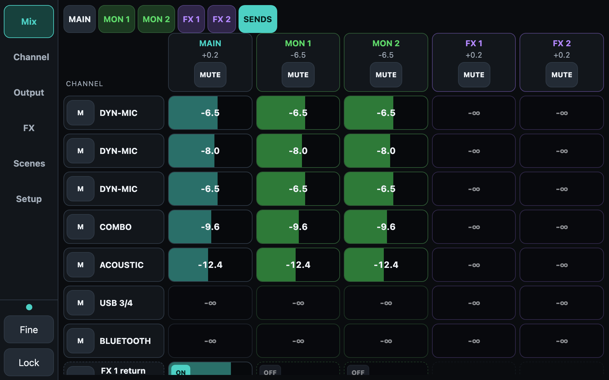

### Channel
Headamp, a drag-to-edit four-band parametric EQ with low cut (every band has its own frequency, gain and Q), and the channel's own fader and meter.

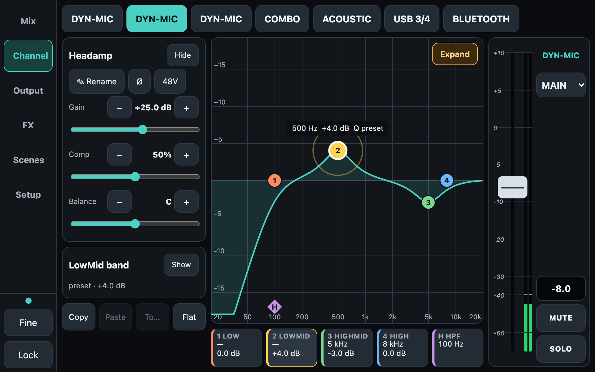

The amber **Expand** button opens the EQ full screen, with a close-up scale (±15 or ±8 dB), the band editor and the channel fader. **Close** returns you.

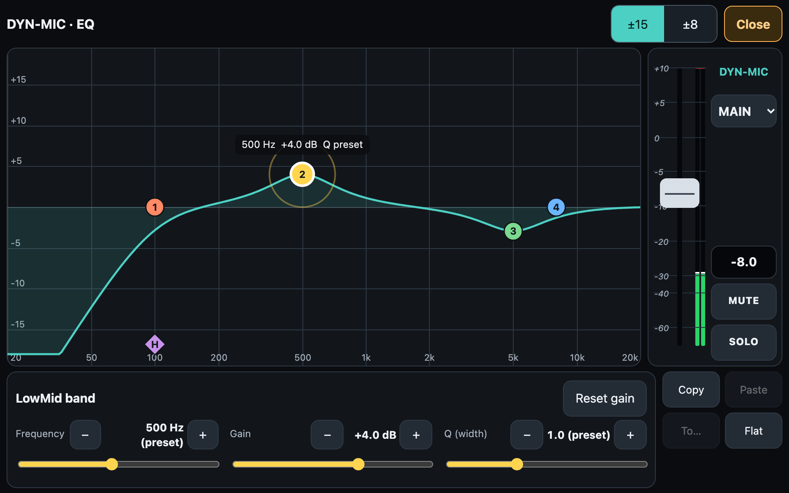

### Output EQ
Each output (Main, Mon 1, Mon 2) has two modes. **GEQ** is nine fixed octave bands: drag up and down, or paint across several bands.

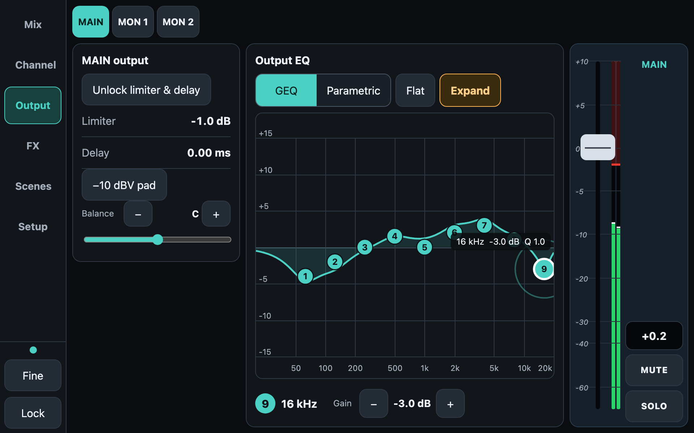

**Parametric** makes each of the nine nodes a bell with its own frequency, gain and Q: drag a node (sideways is frequency, up and down is gain), pinch or scroll for Q, or use the editor row. Lock frequencies and Reset are there too, and Main has a Balance slider. Limiter and delay are locked until you unlock them.

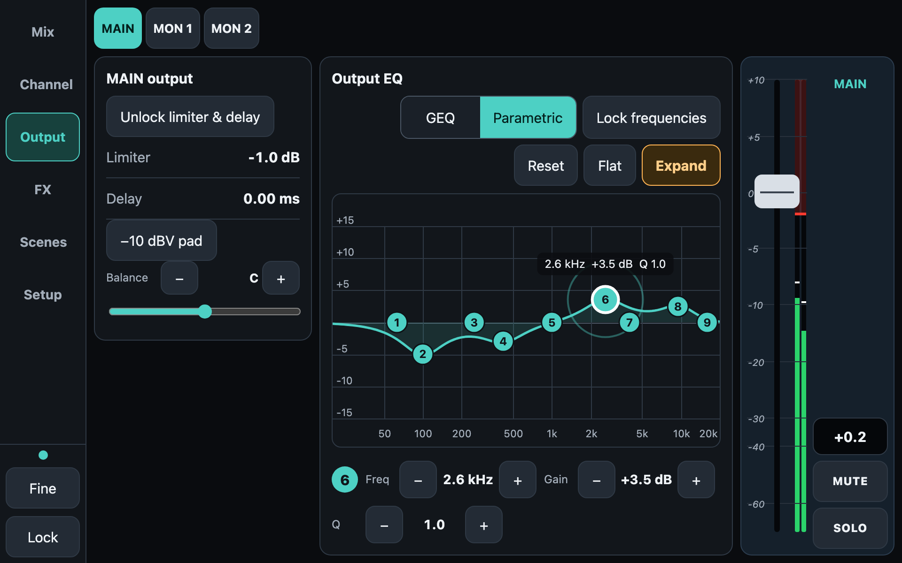

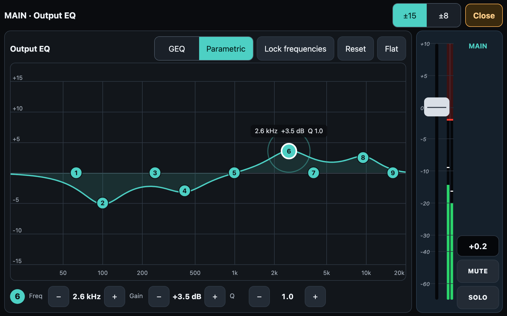

### FX
Presets by name, parameters, routing and the return fader. Delay effects get a tempo card, and the TAP button flashes on every beat.

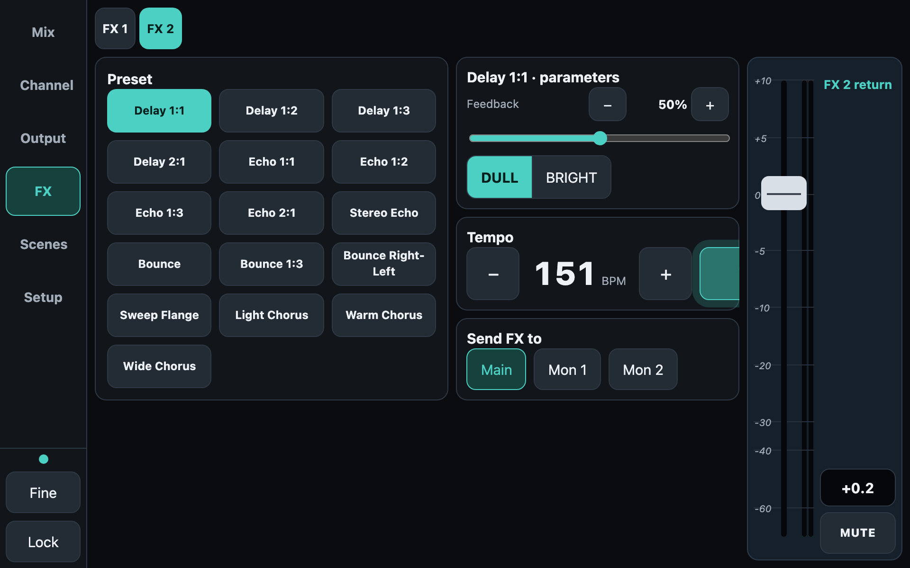

### Scenes
The mixer's snapshot slots plus a local library, 50 in total.

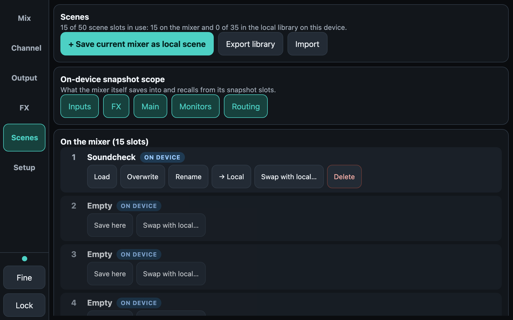

### On a phone
The app fits itself to your screen (Setup has a UI size slider if you want it bigger or smaller). In landscape, all the channels plus Main fit on screen.

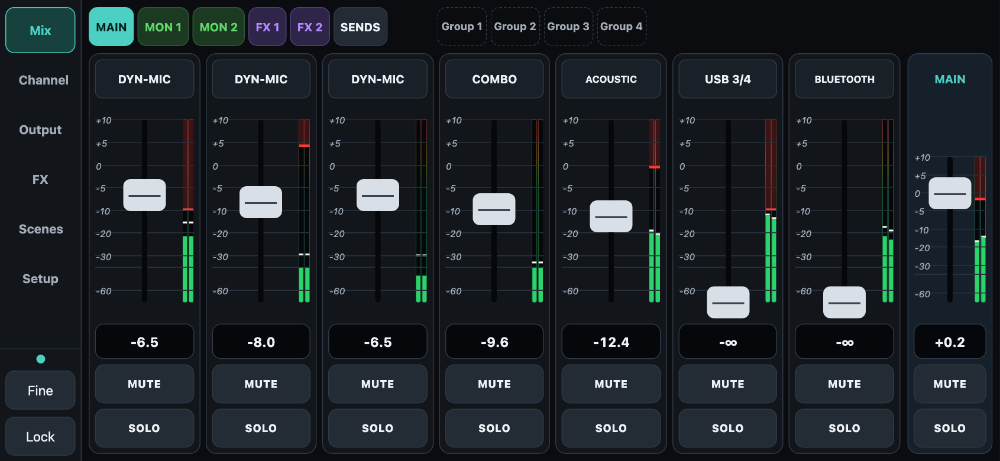

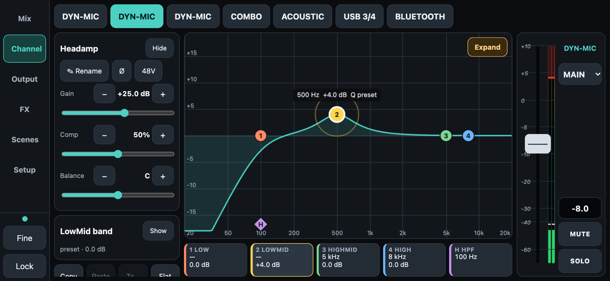

In portrait the navigation moves to the bottom.

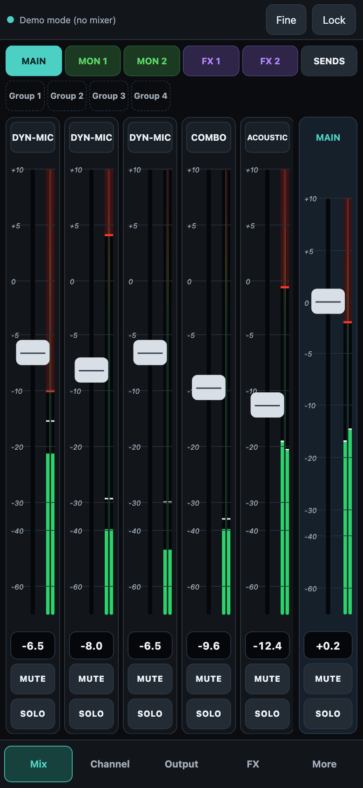 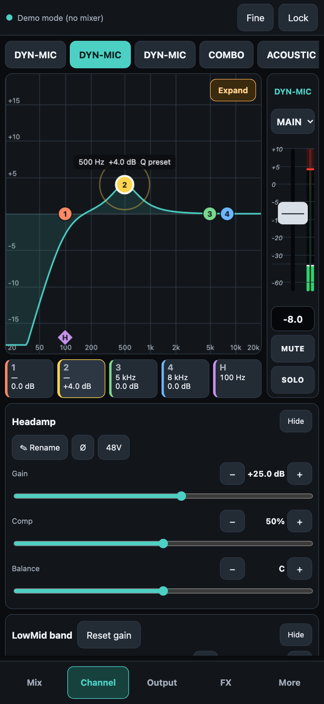

## Good to know

ReFlo+ uses its own names for the FX presets, so they may not match the names in the official app. The effects themselves are the mixer's.

## Support

Found a bug or want a feature? Join the Flow 8 Facebook groups and reach out to me there (Michael Wright). Please say which device and Android / iOS version you use.

## Licence and disclaimer

Free to use, closed source, under the freeware licence in [LICENSE](LICENSE). Please don't sell or repackage it.

ReFlo+ is an independent project, not made, endorsed or supported by Behringer or Music Tribe. "Behringer" and "Flow 8" are trademarks of their owners, used only to say which mixer it works with. It sends live control commands to a mixer (levels, phantom power, routing): use it at your own risk and check settings before a show.

by Michael Wright
