# ReFlo+ features

ReFlo+ is a touch-first controller for the **Flow 8** digital mixer, for iPhone, iPad, Mac and Android. It connects over Bluetooth Low Energy and works only with the Flow 8.

ReFlo+ is an independent app and is not affiliated with, endorsed or sponsored by any mixer manufacturer. "Flow 8" is named only to say which mixer the app works with.

Get it on the **Apple App Store** (one purchase covers iPhone, iPad and Mac) and on **Google Play**. Search for "ReFlo+".

ReFlo+ is built for people who run sound for a living or for fun and want more than the basics: every channel, every mix and every output reachable in a tap or two, with pro-style controls and a page you can build yourself.

## At a glance

- **Sends matrix:** every channel and every mix in one grid.
- **Gains on faders:** the preamp gain of every input on a row of faders, so you set them all in one place.
- **Custom page:** build your own control surface from widgets such as Headphones level, Scene changer, Fade and Mute groups.
- **Gain reduction on the faders:** see the compressor (or limiter) working on every strip.
- **Full channel EQ:** drag the EQ on a graph, with shelving on the outer bands, plus copy and paste between channels.
- **Output tools:** 9-band graphic EQ or parametric EQ, limiter, delay and a delay calculator.
- **Scenes:** the mixer's 15 snapshots plus a local library, 50 in all, with export and import.
- **Stage-ready:** Night (red) and Bright themes, Fine mode and Lock.

## Mix page

- Faders, mute and solo for every channel and the main mix, with live level meters (including the FX 1 and FX 2 returns). Tap the dB number under a fader to type an exact level.
- The tabs at the top choose which mix the faders control: Main, Mon 1, Mon 2, FX 1 and FX 2.
- **Sends matrix:** one grid showing every channel against every mix. Drag a cell sideways to change a send, and use the chip on an FX row to switch that route on or off.
- **FX return meters (2.0.9):** FX 1 and FX 2 show a level meter on the Mix page when you select them, on the FX page, and on the Custom page master faders.
- **Gain reduction on every strip:** a red marker shows how much the compressor is reducing the level, and on a master it shows the limiter.
- **Gains on faders:** a Gains page puts the preamp gain of every input on its own fader (-20 to +60 dB, in 0.5 dB steps) with a meter and a clip indicator, so you can set all the gains in one place instead of opening each channel. Switch it on under Setup, Advanced, Enable Gains on Faders. It is off by default, because a gain change affects the whole signal path.
- Press and hold a channel name to rename it.
- **Mute groups:** four group buttons. Tap to mute or unmute a group; press and hold to choose its channels and name it.
- **Mute all** works like the mixer's own MUTE button: it mutes inputs 1 to 8 (the four mono inputs and the two stereo pairs) and leaves the BT/USB channel playing. It remembers which were live, so one press brings back exactly those.
- Fine mode makes faders move at a quarter of the speed. Lock ignores touches on faders and controls so nothing moves by accident.

## Channel page

- Preamp gain, compressor, balance, polarity flip, 48V (inputs 1 and 2) and low cut for each input.
- A graphical four-band parametric EQ you drag with your finger: sideways for frequency, up and down for gain, pinch for width (Q). Expand it to full screen.
- The lowest and highest bands become shelving filters when their Q is set to 0, as on the mixer.
- Copy, Paste and Flat on the whole channel EQ, so you can copy one channel's EQ to another.

## Output page

- Main, Mon 1 and Mon 2 each have a master strip and output options.
- 9-band graphic EQ with fader-style bands, up to 15 dB either way, or a parametric EQ with draggable nodes. The parametric mode has Lock frequencies, Reset and Flat.
- Limiter and delay, locked by default so they can't be nudged by accident.
- **Delay calculator:** enter the extra distance to a speaker (metres or feet) and the air temperature, and ReFlo+ works out the delay to set.
- Main balance, a -10 dBV pad, and pre- or post-fader taps with stereo link on the monitors.

## FX page

- FX 1 and FX 2 each have presets, a main parameter and a switch, and a Send FX to section that routes the effect to Main, Mon 1 and Mon 2. The return strip beside them has a level meter (2.0.9).
- **Tap tempo** for presets that follow tempo: the tempo is averaged over your last few taps, the TAP button flashes on every beat and the + and - buttons nudge by 1 BPM.
- FX return level and mute.

## Custom page

A blank page that you build yourself. Tap Edit, then Add, and put on exactly the controls you use. Widgets snap to a grid, can be moved and resized, and your layout is saved on the device.

- **Channel fader:** one input channel, with its level in the chosen mix, mute, solo and meter.
- **Master fader:** the Main, Mon 1, Mon 2, FX 1 or FX 2 master level with mute and a level meter (see "Output meters" below).
- **Headphones level:** the headphones output level, the same as the knob on the mixer.
- **Tap tempo:** FX tempo with tap, nudge buttons and a beat flash.
- **FX controls:** the current FX preset name, its main parameter and switch.
- **Mute groups:** the groups you have set up.
- **Fade:** fade a channel or output out and back in over a set time, such as walk-on music.
- **Mute all** and **Clear solo:** one-press safety buttons.
- **Scene changer:** previous and next snapshot on the mixer.
- **Text label:** a heading or note, such as a song name.
- **Analogue channel strip (2.0.8):** one input as a console strip, with big EQ knobs, gain, low cut, compressor, pan, a fader and a segmented level meter. It scales to the size of the widget. Hold the bar at the bottom to open that channel's EQ.
- **Macro knob (2.0.8, experimental):** one slider that moves up to four controls, each along a curve you draw.
- Faders can be rotated to lie on their side and shrunk down to one row or one column.

## Output meters: how many at once

The mixer sends level meters for the inputs and for **one or more outputs**, but it has room for only **five output meter slots** in each update. A stereo meter (left and right) takes two slots, and a mono meter takes one. This matters on the Custom page, where several master faders can be on screen at once.

- On the Mix, FX and Output pages one output is on screen at a time, so it always has a full stereo meter.
- On the Custom page, ReFlo+ asks the mixer for every output that has a master fader on the page. If they all fit as stereo, they all show stereo meters.
- If they do not all fit (for example Main, FX 1 and FX 2 together need six slots), FX 2, then FX 1, then Main are metered as **mono, which is the left channel only**. A mono meter shows the left channel's level on both bars.
- All five outputs (Main, FX 1, FX 2, Mon 1 and Mon 2) fit together as mono. A sixth meter slot does not exist, so there is no way around the limit.
- A master fader widget whose output is not being metered shows no meter instead of a wrong one.

## Scenes

- The mixer's 15 snapshot slots plus a local library on your device, 50 scenes in all.
- Load, save over a slot, rename, or copy a snapshot into the local library.
- Choose what each snapshot saves and recalls: inputs, FX, main, monitors and routing.
- Local scenes also store your mute groups and your Custom page layout.
- Swap a mixer slot with a local scene. Export and import your library as a file.

## Setup and display

- Routing and monitoring switches for USB audio, headphones, monitors, output pads and the foot switch.
- **Follow Mixer:** pressing the mixer's Main, Mon 1, Mon 2, FX 1 or FX 2 button opens that screen in the app, and it can work the other way too.
- Themes: Standard, **Night** (red only, to keep your night vision on a dark stage) and **Bright** (for direct sunlight).
- Keep the screen on while the app is open, an adjustable display size, optional button animation and haptics.
- Interface in English, German, Spanish, French, Italian and Ukrainian.
- Rename the mixer from the app.

## Made for real use

- Works over Bluetooth Low Energy. No account, no cloud and no internet connection needed.
- Your settings and scenes stay on your device. No data is collected; see the [privacy policy](privacy).
- No ads, no subscription, no in-app purchases. One payment, yours to keep.

## Screenshots

### iPad

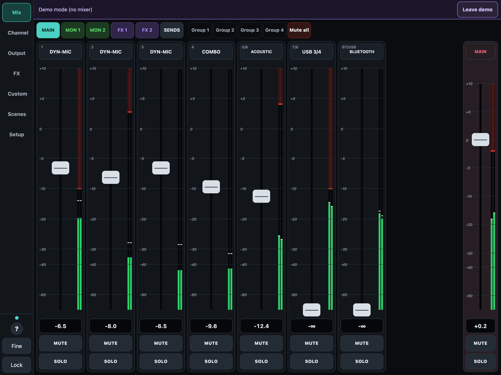
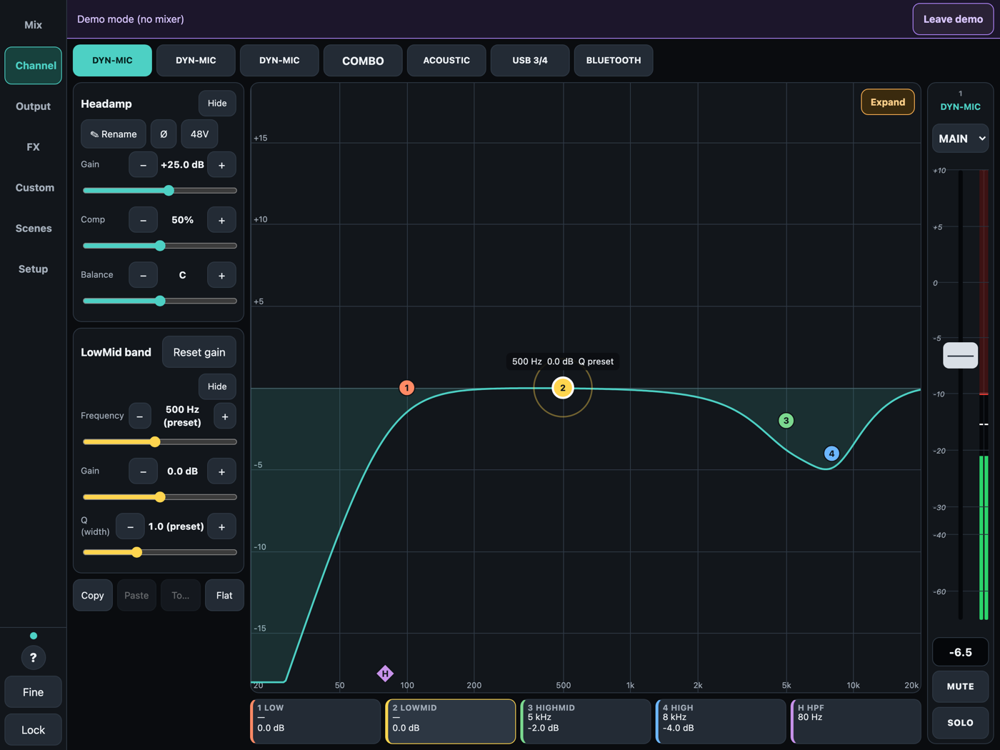
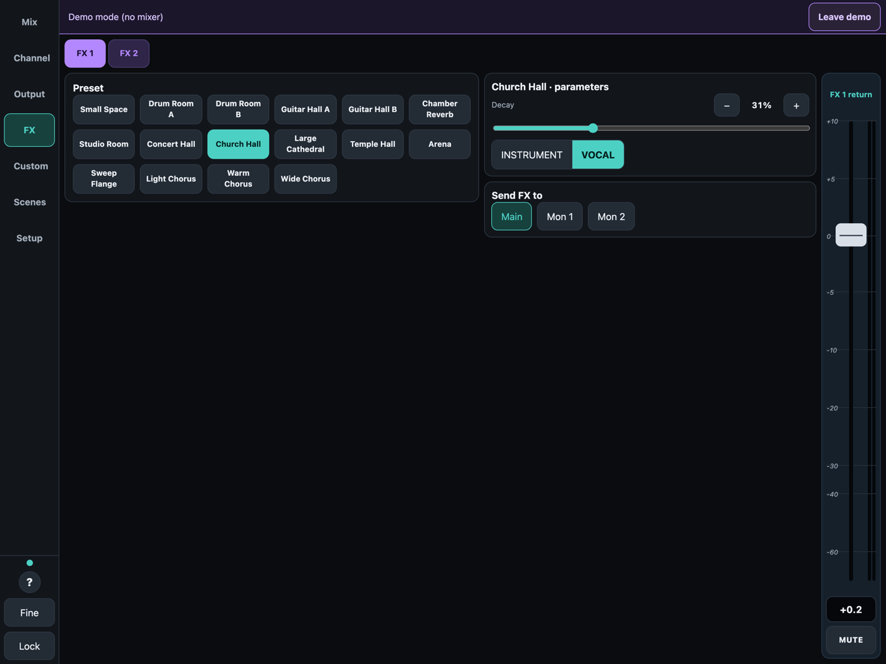
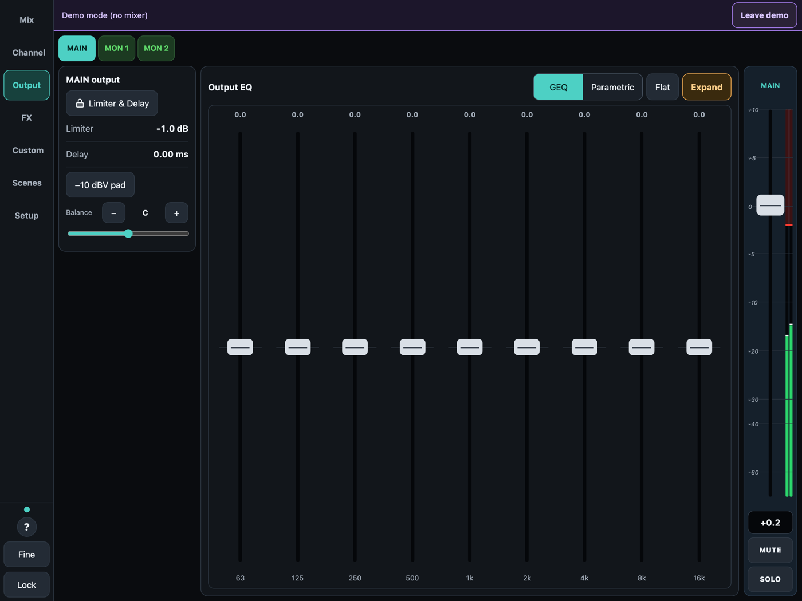
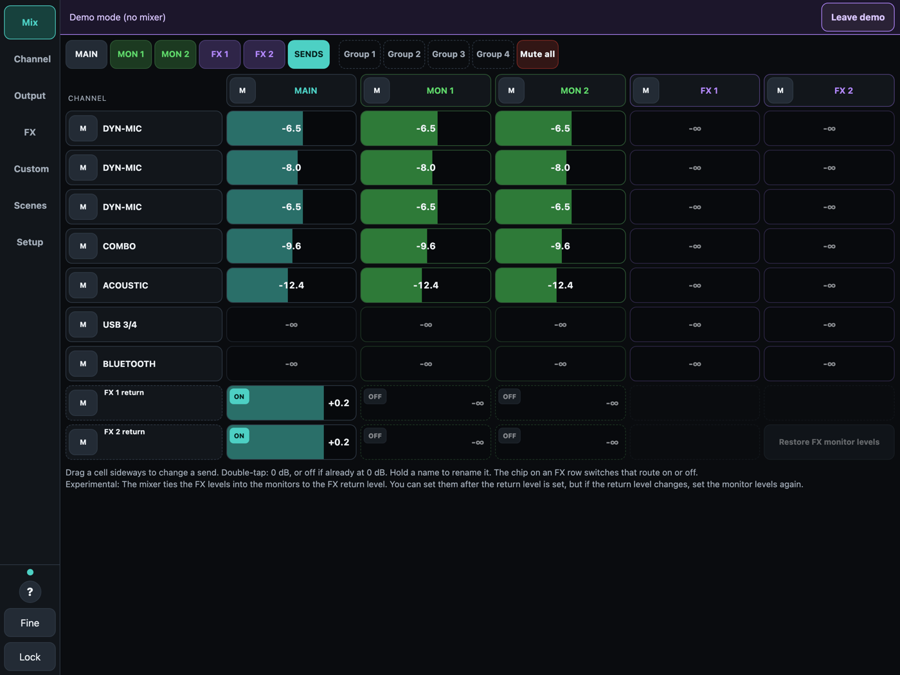
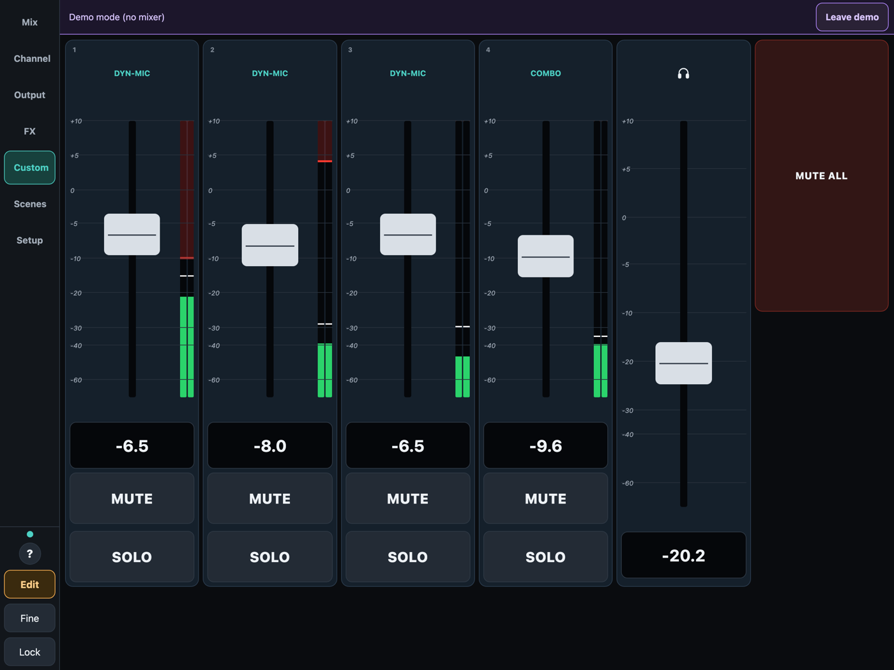

### iPhone

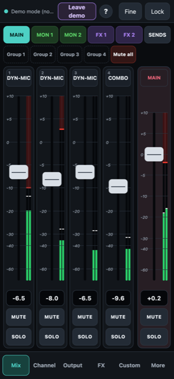 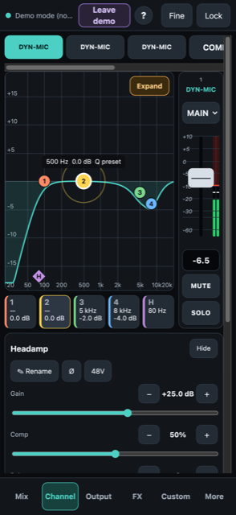 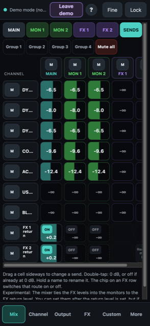
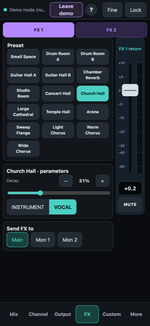 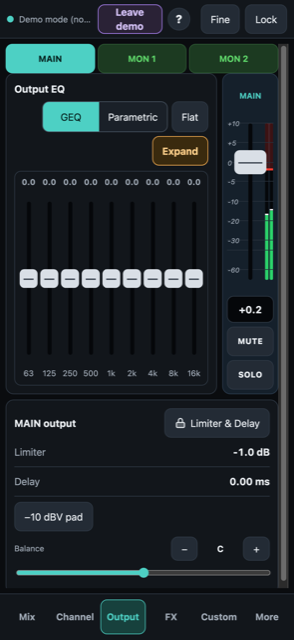 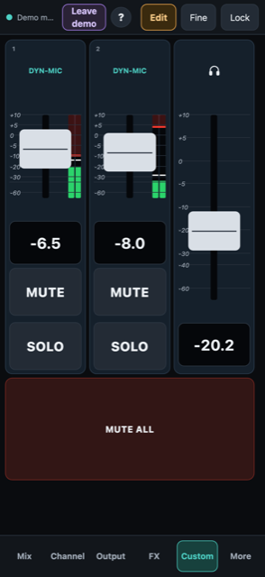

## Good to know

- ReFlo+ works only with the Flow 8. The mixer must be in pairing mode to connect.
- ReFlo+ sends live commands to your mixer (levels, phantom power, routing). Check settings before use and keep headphone levels safe.

## Support

devcrest.support@gmail.com · [Privacy policy](privacy)

DevCrest (Michael Wright), South Africa.
